  

I build AI systems and then try hard to prove myself wrong about them: held-out tests, bootstrap intervals, the baseline everyone skips, and a written account of what didn't work. Every project below states its result in one line, and the repo shows how to reproduce it.

### `$ cat experiments.log`

| run | project | result |
| :-- | :-- | :-- |
| `07` | [**uplift-targeting**](https://github.com/masooddahmedd/uplift-targeting) Who should get the discount? (14M-user randomized experiment) | targeting the top 30% lifts ad profit **+40%**; for coupons, targeting doesn't pay |
| `06` | [**agentic-rag-evals**](https://github.com/masooddahmedd/agentic-rag-evals) Is an agent actually better grounded than plain RAG? | **82% vs 71%** of answers fully source-backed, 32% fewer tokens |
| `05` | [**realtime-voice-agent**](https://github.com/masooddahmedd/realtime-voice-agent) Can a voice agent let you pause to think without getting slower? | **0/10 vs 10/10** thinking pauses cut off, same 1.0 s median reply |
| `04` | [**receipt-slm**](https://github.com/masooddahmedd/receipt-slm) Can a 1.5B fine-tune replace an API call? | **80.7% vs 72.7%** field accuracy vs gpt-4o-mini; 512 receipts/min on one GPU |
| `03` | [**freight-rate-prediction**](https://github.com/masooddahmedd/freight-rate-prediction) How well can freight rates be forecast, judged forward in time? | **1.9% vs 3.4%** MAPE against the lane-median baseline |
| `02` | [**roman-urdu-retrieval**](https://github.com/masooddahmedd/roman-urdu-retrieval) What does typing Urdu in Latin script do to semantic search? | embedders lose **29–59 pts** of Recall@5; transliteration recovers most of it |
| `01` | [**receipt-cascade**](https://github.com/masooddahmedd/receipt-cascade) When is the cheap model good enough? | cascade **18% cheaper** than gpt-4o at −1.4 pts; image input made the "cheap" model pricier |

### `$ head -1 papers.bib`

**Roman Urdu Breaks Dense Retrieval: Script, Spelling Variation and a Transliteration Fix.** M. Ahmed, 2026. Preprint.

### `$ ls ~/private`

Work that lives in private or client repos, so here are the numbers instead of the code:

- **Roman Urdu text-to-speech** — fine-tuned Orpheus-3B; first audio in **235 ms** (from 1.2–2 s) with vLLM FP8 and GPU audio decoding.
- **Urdu speech corpus** — a pipeline that turned 709 crawled channels into **~1,450 hours** of clean, transcribed, speaker-clustered audio.
- **Long context on a consumer GPU** — a 27B coding model served at **128k tokens** on one 16 GB card, 87 tok/s, 3/3 needle recall at 116k.
- **Broadcast football tracking** — players located in real pitch coordinates, pitch calibrated on **98%** of frames.
- **Football Players dataset** — [83K+ views, 18K+ downloads](https://www.kaggle.com/datasets/maso0dahmed/football-players-data) on Kaggle.

### `$ cat now.md`

Leading an AI squad at Walee Technologies, competing in Kaggle's *Name That LLM*, and building a Muslim companion chatbot that cannot misquote scripture: the model returns references and code inserts the verified text.

### `$ echo $STACK`

`python` `pytorch` `lightgbm` `vllm` `llama.cpp` `langgraph` `pgvector` `whisper` `fastapi` `docker` `linux`

### `$ contact`

[masoodd.ahmedd123@gmail.com](mailto:masoodd.ahmedd123@gmail.com) · [LinkedIn](https://www.linkedin.com/in/masoooddd/) · [Kaggle](https://www.kaggle.com/maso0dahmed) · [Zenodo](https://doi.org/10.5281/zenodo.24384589)

The header is hand-written SVG: no images, no third-party widgets. Regenerate it with <code>python tools/build_hero.py</code>.
